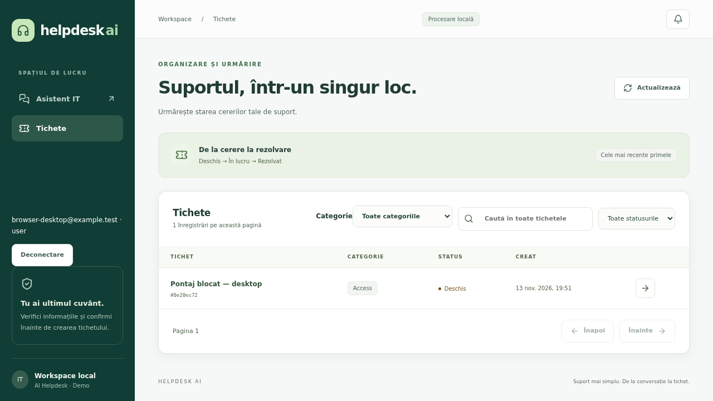
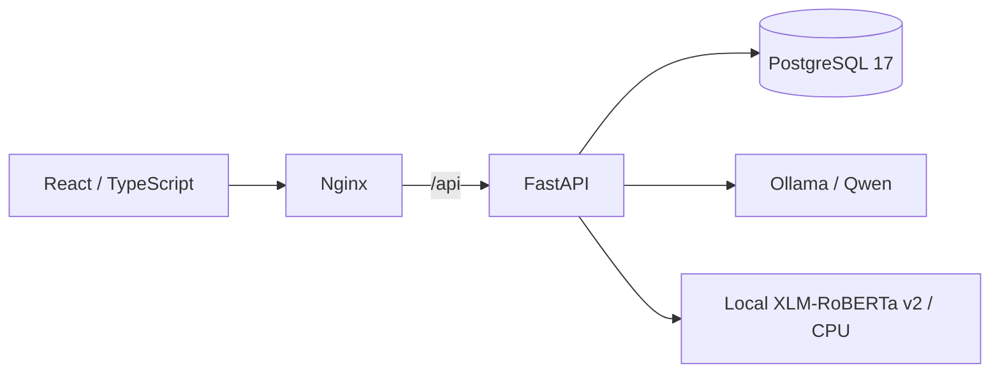

# AI Helpdesk

AI Helpdesk turns an IT support conversation into a ticket that a person reviews and confirms. It supports Romanian and English conversations, keeps the original classifier prediction separate from the support team's final category, and provides a shared ticket workflow with public replies and private notes. The application is designed for local portfolio demonstrations.



Actual application capture from the desktop Playwright run on November 13, 2026. The account and ticket are synthetic; the browser test uses real HTTP and PostgreSQL with simulated model responses. The interface remains in Romanian. Follow the [demo walkthrough](docs/DEMO.md) to exercise the real models.

## Workflows

- **User:** register, describe a problem, edit the generated draft, declare its impact, and explicitly confirm ticket creation. Return to conversation history, exchange public replies, and reopen a resolved ticket with a reason.
- **Support:** filter tickets, claim or reassign them, set priority, reply publicly, add internal notes, and resolve with a message. A dashboard shows descriptive workload and response metrics; in-app notifications track relevant changes.
- **ML review:** support can explicitly approve a category label and export reviewed examples. Changing ticket text or category invalidates that review. Exports contain ticket text and require privacy review before reuse; they do not trigger retraining.

Confirmation uses database locking and a unique conversation-to-ticket constraint to prevent duplicates. The frontend checks the saved conversation after an ambiguous confirmation response so a lost response does not require creating another ticket. Version checks protect concurrent support edits. Internal notes are excluded from user responses.

## Architecture



React 19 and Vite provide the interface. Nginx serves the production frontend and proxies API requests. FastAPI stores accounts, revocable sessions, conversations, tickets, messages, notifications, and audit events in PostgreSQL. Versioned SQL migrations run before API startup.

The models have separate responsibilities:

| Component | Responsibility | Boundary |
|---|---|---|
| Qwen (`qwen3:4b-instruct` through Ollama) | Ask clarifying questions and generate an editable title/description draft | Does not save or resolve tickets; draft generation receives only user messages to reduce copying of assistant suggestions |
| XLM-RoBERTa v2 | Classify the confirmed title and description into eight categories | Does not assign urgency or generate replies; the original prediction and model version remain available after support corrections |

The supplied Compose configuration reserves an NVIDIA GPU for Ollama and runs the classifier on CPU. This keeps GPU allocation simple, but the default stack requires NVIDIA support. Human confirmation handles model errors; it does not guarantee that a draft or classification is correct.

## Run locally

Requirements: Docker Engine with Compose v2, an NVIDIA GPU available to Docker through NVIDIA Container Toolkit, and the local v2 classifier artifacts. Datasets and trained weights are excluded from Git. A fresh checkout cannot run real inference until those artifacts are supplied; the repository does not provide a model download command.

Place the classifier files under:

```text
ml/models/xlm_roberta_helpdesk_v2/model/
  config.json
  model.safetensors
  tokenizer.json
  tokenizer_config.json
```

From the repository root, create `.env` only if it does not exist:

```bash
[ -f .env ] || cp .env.example .env
```

Set `POSTGRES_PASSWORD` in that file. Preserve the password of an existing database. For local HTTP, use `APP_ORIGIN=http://127.0.0.1:5173` and `COOKIE_SECURE=false`.

```bash
docker compose up -d ollama
docker compose exec ollama ollama pull qwen3:4b-instruct
docker compose up -d --build
docker compose ps
```

Open <http://127.0.0.1:5173>. Public registration creates a user account. Create a separate support account with the interactive password prompt:

```bash
docker compose exec api python -m backend.app.manage create-support --email support@example.com
```

Stop services with `docker compose stop` to retain their volumes. Before upgrading an existing database, follow the [backup, restore verification, and migration instructions](docs/OPERATIONS.md). The same guide covers configuration, development, and troubleshooting. Use the exact configured browser origin: `localhost` and `127.0.0.1` are different origins.

## Testing and CI

GitHub Actions runs backend tests, frontend lint and tests, a production build, and Playwright flows in desktop Chromium and an emulated Pixel 7. Tests use a separate PostgreSQL database and simulated inference, so they require neither model weights nor a GPU. Authentication, SQL, and HTTP remain real in the browser tests.

See [local test setup and commands](docs/OPERATIONS.md#testing). The recorded final integration checks include 57 backend tests, 24 frontend tests, and four browser tests, plus fresh/upgrade migrations, Nginx, API restart persistence, and real RO/EN model smoke tests in an isolated stack. These are recorded results from November 13, 2026, not a claim that tests have been rerun for every later documentation change. [Verification records](docs/IMPLEMENTATION_PLAN.md) link the corresponding CI runs and describe their limits.

## ML results

The checked-in [evaluation report](ml/reports/reproducible_v1_v2_baseline.json) separates model versions and datasets. Accuracy values below come from that recorded local inference run:

| Evaluation set | TF-IDF + SVM | XLM-R v1 | XLM-R v2 |
|---|---:|---:|---:|
| Grouped English validation, 4,784 rows | 0.8612 | 0.8798 | 0.8142 |
| Romanian pilot, 16 scenarios | 0.1250 | 0.1875 | 0.5625 |
| English pilot, translations of the same 16 scenarios | 0.3125 | 0.2500 | 0.6250 |

The English validation split was available during v2 model selection, so it is not an independent holdout. The pilot consists of only 16 paired synthetic scenarios; translations are not independent observations. V2 improves on this small pilot while regressing on the English validation set. It is the configured application classifier, but these results do not establish general performance on real tickets.

The historical [grouped test report](ml/reports/grouped/test_comparison.json) compares SVM with v1 only; it is not a v2 test result. [ML evaluation](docs/ML_EVALUATION.md) provides macro-F1, provenance, reproduction commands, and training reproducibility limits. [Dataset assessment](docs/dataset_assessment.md) explains source and split decisions.

## Limitations and next steps

- Qwen can repeat questions, generalize details, or miss language changes. Draft editing and explicit confirmation remain necessary. Short real-model smoke tests validate the workflow, not overall language quality.
- XLM-R truncates inputs to 256 tokens and returns an uncalibrated category. It has no reliable out-of-domain detection. Full v2 training code/configuration is not versioned, so the supplied evaluation script reproduces inference and metrics, not training.
- Password recovery, email verification, MFA, and account administration are absent. The current proxy configuration shares authentication rate limits across clients. Public hosting would require HTTPS configuration, an operational backup/retention policy, and further security review.
- Browser coverage is Chromium desktop and mobile emulation. The targeted keyboard and contrast checks are not a complete accessibility audit; Firefox, Safari, and physical devices remain unverified.

Useful next steps are an independently held-out bilingual evaluation set with scenario-level separation, versioned v2 training configuration, broader accessibility/browser checks, and account recovery. These are planned improvements, not implemented features.

The working branch contains the five implementation stages described in the [implementation and verification record](docs/IMPLEMENTATION_PLAN.md). The recorded PRs form a chain and have not been merged into the default branch. The documentation describes the code in this checkout; it does not imply that the running application has been upgraded to it. Endpoint contracts are documented in the [API reference](docs/API.md).
