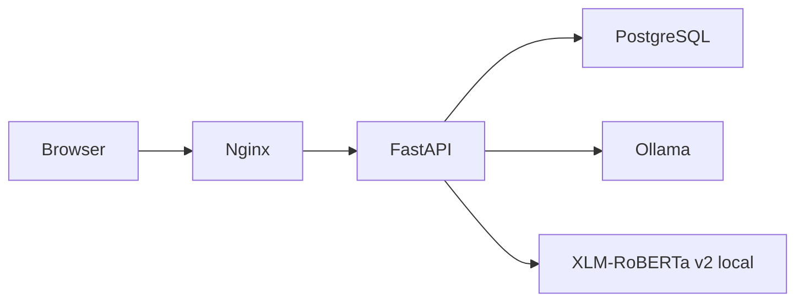

# AI Helpdesk

Aplicație locală de portofoliu pentru suport IT în română și engleză. Utilizatorul discută cu un asistent, verifică o ciornă editabilă și confirmă explicit crearea tichetului. Suportul preia tichetul, răspunde public sau adaugă note interne și rezolvă problema cu un mesaj explicit. Proprietarul sau suportul poate redeschide cu motiv.

## Arhitectură

- React 19, TypeScript și Vite; în Docker, Nginx servește frontendul și transmite `/api` către FastAPI.
- FastAPI și psycopg; PostgreSQL 17 persistă utilizatorii, sesiunile, conversațiile, tichetele și istoricul schimbărilor.
- Ollama cu `qwen3:4b-instruct` generează conversații și ciorne JSON.
- XLM-RoBERTa v2 clasifică local titlul și descrierea în opt categorii. Predicția originală, categoria finală și versiunea modelului sunt păstrate separat.
- Migrări SQL versionate, executate înaintea API-ului; fără cloud, RAG sau Kubernetes.



## Cerințe

Docker Engine și Compose v2. Configurația Ollama existentă solicită un GPU NVIDIA și NVIDIA Container Toolkit. Asigură-te că GPU-ul este disponibil pentru Docker. Clasificatorul din imaginea API folosește PyTorch CPU; GPU-ul este rezervat Ollama.

Modelul antrenat trebuie să existe în:

```text
ml/models/xlm_roberta_helpdesk_v2/model/
  config.json
  model.safetensors
  tokenizer.json
  tokenizer_config.json
```

Directorul este montat numai pentru citire. API nu descarcă și nu reantrenează modele. Dataseturile și ponderile nu sunt incluse în Git; proiectul nu poate porni inferența reală dintr-un checkout fără aceste artefacte.

## Instalare și pornire

1. Copiază `.env.example` în `.env` dacă nu ai deja configurația locală. **Nu suprascrie `.env` existent.** Completează `POSTGRES_PASSWORD` cu o parolă aleasă local. Păstrează parola bazei existente la actualizare: schimbarea variabilei nu schimbă parola dintr-un volum PostgreSQL deja inițializat.
2. Pentru HTTP local: `APP_ORIGIN=http://127.0.0.1:5173`, `COOKIE_SECURE=false`. Pentru HTTPS setează originea exactă și `COOKIE_SECURE=true`. Folosește aceeași adresă în browser; `localhost` și `127.0.0.1` sunt origini diferite.
3. La prima instalare, pornește Ollama și încarcă modelul:

```bash
docker compose up -d ollama
docker compose exec ollama ollama pull qwen3:4b-instruct
```

4. Pornește întreaga aplicație:

```bash
docker compose up -d --build
```

Interfață: <http://127.0.0.1:5173>. API/OpenAPI: <http://127.0.0.1:8000/docs>. PostgreSQL pe gazdă: `127.0.0.1:5434`; în Docker: `db:5432`. Nu este necesar fișierul suplimentar `compose.frontend.yaml`; este păstrat pentru compatibilitate.

```bash
docker compose ps
docker compose logs --tail=100 api frontend
docker compose exec api python -m backend.app.manage create-support --email support@example.com
```

Comanda support cere parola fără afișare și creează un cont nou; nu promovează automat un cont existent. Nu există parole implicite. Înregistrarea publică din interfață creează exclusiv rolul `user`.

Pentru oprire fără ștergerea datelor:

```bash
docker compose stop
```

Serviciile au `restart: unless-stopped`. API așteaptă PostgreSQL și Ollama sănătoase și aplică migrările înainte de încărcarea clasificatorului. Healthcheckul API verifică baza de date; încărcarea clasificatorului se face înainte ca API să accepte cereri. `ollama list` verifică serviciul, nu existența modelului Qwen: încărcarea lui este pas explicit. Un healthcheck eșuat nu repornește singur un container încă activ.

## Migrări și date existente

Migrarea 005 este necesară pentru colaborare. Păstrează datele și ownerii existenți; adaugă prioritate normal, versiune 0 și responsabil neatribuit. Datele necunoscute nu sunt inventate. Fă backup și verifică restore înainte de upgrade, conform [ghidului de operare](docs/OPERATIONS.md).

```bash
docker compose run --rm --no-deps api python -m backend.app.manage migrate
```

Runnerul păstrează `schema_migrations`, execută în ordine fișierele din `backend/migrations` și folosește o blocare tranzacțională pentru porniri concurente. Adoptă migrările originale 001–003 aplicate manual numai după compararea coloanelor (tip, nullabilitate, identity, default), constrângerilor și indexurilor cu o schemă de referință creată tranzacțional din SQL-ul original. O schemă parțială sau incompatibilă oprește migrarea cu un mesaj explicit și rollback. Runnerul necesită dreptul de a crea o schemă de referință temporară în baza țintă; nu introduce date în aceasta. Migrările deja înregistrate nu sunt revalidate automat. Nu edita migrări deja aplicate; adaugă un fișier nou.

Migrarea 004 adaugă proprietarii fără a atribui datele vechi unui cont. Utilizatorii obișnuiți nu văd conversațiile sau tichetele fără proprietar. Suportul poate administra toate tichetele, inclusiv cele istorice; conversațiile fără proprietar nu sunt expuse în interfață. O eventuală atribuire ulterioară cere o decizie explicită și o migrare separată.

Nu se șterg volume, date sau modele. Înaintea actualizării unei baze importante, păstrează un backup PostgreSQL în afara repository-ului.

## Roluri și sesiuni

- **user:** conversații și tichete proprii, ciornă editabilă, confirmare, urmărirea statusului și istoricului.
- **support:** aceleași funcții personale, plus acces la toate tichetele, filtre de atribuire/prioritate, preluare și reasignare, prioritate `low`/`normal`/`high`/`urgent`, rezolvare cu răspuns, dashboard descriptiv, notificări în aplicație, revizuire explicită a categoriei pentru evaluare ML și export CSV minimal.
- Parole cu scrypt și sare aleatoare; sesiuni opace stocate în DB prin hash, cookie HttpOnly/SameSite=Lax, expirare la 8 ore și invalidare la logout. Tokenul CSRF este asociat sesiunii și transmis prin antet la operațiile de scriere; verificarea originii completează protecția. Repere: [OWASP sesiuni](https://cheatsheetseries.owasp.org/cheatsheets/Session_Management_Cheat_Sheet.html), [OWASP CSRF](https://cheatsheetseries.owasp.org/cheatsheets/Cross-Site_Request_Forgery_Prevention_Cheat_Sheet.html).
- Login și înregistrare au limitare persistentă de 30 cereri / 10 minute per conexiune directă și operație. În configurația proxy locală, utilizatorii împart această limită; aplicația este destinată demonstrației locale.

## Flux și API

1. `POST /auth/register`, `POST /auth/login`, `GET /auth/me`, `POST /auth/logout`.
2. `POST /conversations`, `GET /conversations`, `GET /conversations/{id}`, `GET/POST /conversations/{id}/messages`.
3. `POST /conversations/{id}/ticket-draft` generează o propunere fără salvare ca tichet.
4. `POST /conversations/{id}/tickets` cere `title`, `description`, `last_message_id`, `confirmed: true` și acceptă impactul declarat opțional (`individual`, `team`, `organization`). Recalculează categoria pe textul editat. Respinge ciorne depășite și duplicate; blocarea rândului și constrângerea unică protejează și cererile concurente. `POST /tickets` răspunde 410 pentru a închide vechea cale fără confirmare.
5. `GET /tickets` acceptă `search`, `status`, `category`, `priority`, `assigned_to_me`, `unassigned`, `limit` și `offset`. Ordine: `created_at DESC, id DESC`; căutarea literală, fără diferență de majuscule, acoperă titlu, descriere și UUID. Paginarea offset poate reflecta inserări noi între cereri.
6. `GET /tickets/{id}`, `PATCH /tickets/{id}` (support: categorie/status/prioritate cu versiune), `GET /tickets/{id}/events`. Auditul tranzacțional păstrează actorul, momentul și valorile vechi/noi; salvările fără schimbare nu creează evenimente.
7. `/support/dashboard` raportează distribuții și timpi descriptivi pentru ultimele 30 de zile; notificările persistente sunt actualizate în UI la 30 secunde. Formulele și excluderile sunt documentate în [API](docs/API.md). Valorile nu sunt SLA-uri.
8. `POST /predict` este autentificat; `GET /health` este public.

Conversațiile convertite sunt închise pentru mesaje noi. ID-ul conversației active este reținut local per cont, iar mesajele sunt recuperate din DB. Mesajul nesent și ciorna editată sunt păstrate în `sessionStorage`, separat per cont și conversație, în fila curentă. Nu sunt stocate credențiale sau tokenuri de autentificare. Datele editorului se curăță la logout/expirarea sesiunii și după trimitere/confirmare reușită. Închiderea filei încheie această recuperare; blocarea storage-ului în browser o poate dezactiva. O ciornă depășită nu este restaurată, iar o conversație convertită este recuperată din server fără suprascriere cu o ciornă locală.

Cererile frontend au un timeout de 150 secunde. După o confirmare cu răspuns pierdut, JSON/tichet invalid, timeout sau eroare ambiguă de proxy, interfața citește tichetul asociat conversației. Afișează succes numai după un răspuns valid de la server. Dacă rezultatul rămâne incert, „Verifică rezultatul” recitește starea înainte să permită retry; un istoric modificat cere regenerarea ciornei. Blocarea și constrângerea unică din backend previn duplicatele inclusiv când prima cerere este încă în curs.

## Dezvoltare și testare

Frontend manual (oprește doar frontendul Docker dacă ocupă 5173):

```bash
cd frontend
npm ci
npm run dev
```

Backend local: Python 3.13, mediul virtual activ, dependențele din `backend/requirements.runtime.txt` constrânse de `backend/requirements.lock.txt`, PostgreSQL pe 5434 și Ollama accesibil. Pentru migrări și CLI este suficient setul ușor `backend/requirements.test.txt`; inferența reală necesită dependențele runtime.

### Teste automate fără modele sau GPU

Creează o bază separată `ai_helpdesk_test`; testele nu creează baza și nu folosesc `ai_helpdesk`. Rolul de test trebuie să poată crea scheme în ea. Fiecare test utilizează o schemă aleatoare, eliminată la final. Nu rula testele cu acces la o bază de producție.

```bash
python -m pip install -r backend/requirements.test.txt
# Configurează POSTGRES_HOST, POSTGRES_PORT, POSTGRES_USER și POSTGRES_PASSWORD pentru baza de test.
python -m pytest backend/tests -q --tb=short
cd frontend
npm ci
npm run typecheck
npm run lint
npm test
npm run build
npx playwright install chromium
npm run test:e2e
```

Testele de browser folosesc o schemă separată în `ai_helpdesk_test`, API pe 8001, frontend pe 5174, răspunsuri ML/LLM simulate și date de autentificare exclusiv de test. Implicit PostgreSQL pentru browser este pe 55434; setează `POSTGRES_PORT` pentru instalația ta. `E2E_PYTHON` selectează interpretul Python, de exemplu `../.venv/bin/python`. Nu există mod de inferență simulată activabil în serverul de producție. În test server, parola `test-only` este destinată exclusiv PostgreSQL-ului izolat de test. Rulează browserul împotriva unui container de test cu autentificare trust pe loopback, conform CI; nu împotriva instanței aplicației.

GitHub Actions rulează backend, lint, teste frontend, build și browser desktop/mobil cu PostgreSQL temporar. Nu descarcă modele și nu necesită GPU. Verificarea manuală cu modelele reale este descrisă în [docs/DEMO.md](docs/DEMO.md).

## Limitele reale ale modelelor

- Qwen poate repeta întrebări, rata schimbări de limbă sau introduce detalii neconfirmate. Generatorul ciornei primește numai mesajele utilizatorului, în ordine, pentru a exclude întrebările și exemplele asistentului din sursa factuală. În verificarea reală au apărut întrebări repetitive și generalizări precum „niciun port” în loc de „alt port”. Prompturile cer o clarificare odată și respectarea corecturilor, dar nu garantează rezultatul; ciorna rămâne editabilă și confirmarea este obligatorie.
- Context Ollama: 2048 tokeni; maximum 16 mesaje deja existente și 4000 caractere la verificarea unei noi intrări. Răspunsurile folosesc maximum 400 tokeni generați. Limita în caractere nu garantează încadrarea în contextul tokenizat.
- XLM-R v2 trunchiază la 256 tokeni și întoarce o categorie, fără probabilități calibrate sau detecție sigură a cazurilor din afara domeniului.
- Raportul `ml/reports/grouped/test_comparison.json` compară baseline SVM și XLM-R anterior; **nu reprezintă rezultatele v2**.
- Adaptarea bilingvă v2 este un experiment pe un set mic. `ml/reports/v1_v2_bilingual_holdout.csv` conține 16 scenarii în două limbi; nu justifică afirmații despre performanța generală pe tichete reale. Separarea scenariilor și reproducerea experimentului sunt necesare înaintea oricărei concluzii mai largi.
- Nu sunt implementate recuperarea parolei, verificarea emailului, MFA sau administrarea conturilor. Pentru expunere publică sunt necesare HTTPS, operare/backup, o politică de retenție și o analiză suplimentară de securitate.

## Evaluare ML reproductibilă

Modelele și dataseturile nu sunt incluse în Git. Cu artefactele locale v1/v2, baseline-ul grouped și mediul CPU din backend instalat, rulează:

```bash
.venv/bin/python ml/src/reproduce_evaluation.py
```

Pentru un mediu separat, instalează PyTorch CPU din indexul oficial PyTorch și apoi `ml/requirements.evaluation.txt`. Scriptul rulează doar inferență și scrie un raport JSON fără texte în `ml/reports/reproducible_v1_v2_baseline.json`. Nu reantrenează modele și nu evaluează v2 pe grouped test. Detalii, limitări și scorurile efective: [docs/ML_EVALUATION.md](docs/ML_EVALUATION.md).

## Starea implementării

Planul, criteriile și rezultatele verificate: [docs/IMPLEMENTATION_PLAN.md](docs/IMPLEMENTATION_PLAN.md). Scenariu RO/EN: [docs/DEMO.md](docs/DEMO.md).

## Livrarea în curs

Etapele 1–4 sunt publicate în branchuri tematice cu CI reușit pentru fiecare PR din lanț. Etapa 4 adaugă revizuire ML explicită, export support-only minim și evaluare reproductibilă pentru artefactele locale disponibile; nu reantrenează și nu schimbă modelul activ. Etapa 5 a verificat local integrarea prin Nginx, migrarea de la zero, restartul și fluxuri RO/EN reale într-un stack temporar izolat. Detaliile și limitele sunt în [planul de implementare](docs/IMPLEMENTATION_PLAN.md). Livrarea finală a etapei 5 și verificarea CI sunt încă în curs; PR-urile nu sunt integrate în branchul implicit.

Reguli API: [docs/API.md](docs/API.md). Backup/restore și pregătirea mediului: [docs/OPERATIONS.md](docs/OPERATIONS.md).
